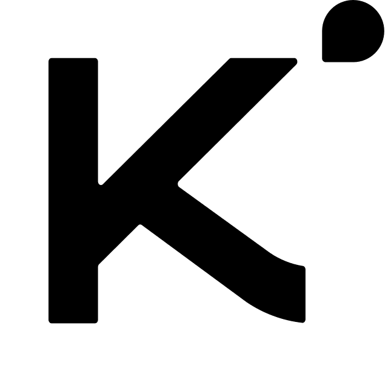
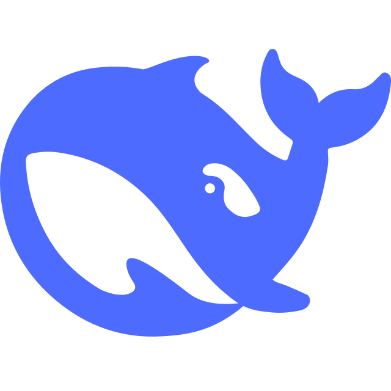

<div align="center">


</div>

### 🧑‍💻 About Me

```console
$ whoami
CN_CoreSteb · IT (Software Development) student @ QUT, Brisbane

$ cat ./now
> building AtmoSeq (象序临近), a weather analysis platform
> multi-layer stacking · custom products · multi-source data
> orchestrating AI agents for day-to-day coding
> running local LLMs for automated code review
> self-hosting production on my own rack servers

$ ls ~/interests
meteorology/   geospatial/   digital-twin/
local-llm/     ar-glasses/   networking/

$ uptime
linux user since 2020

$ locale
zh_CN.UTF-8  en_AU.UTF-8
```

🌩️ **AtmoSeq** → [atmoseq.com](https://www.atmoseq.com/)

### 🤖 AI Stack

<div align="center">
<picture><source media="(prefers-color-scheme: dark)" srcset="./assets/icons/openai-dark.png" /></picture>&nbsp;&nbsp;&nbsp;&nbsp;
&nbsp;&nbsp;&nbsp;&nbsp;
&nbsp;&nbsp;&nbsp;&nbsp;
<picture><source media="(prefers-color-scheme: dark)" srcset="./assets/icons/kimi-dark.png" /></picture>&nbsp;&nbsp;&nbsp;&nbsp;
&nbsp;&nbsp;&nbsp;&nbsp;
<picture><source media="(prefers-color-scheme: dark)" srcset="./assets/icons/zai-dark.png" /></picture>
<br />
<sub>GPT · Claude · Gemini · Kimi · DeepSeek · GLM</sub>
</div>

### ⏱️ Coding Time

<div align="center">
<picture>
  <source media="(prefers-color-scheme: dark)" srcset="https://raw.githubusercontent.com/CNCoreSteb/CNCoreSteb/waka/waka-dark.svg" />
  <source media="(prefers-color-scheme: light)" srcset="https://raw.githubusercontent.com/CNCoreSteb/CNCoreSteb/waka/waka-light.svg" />
  
</picture>
</div>

### 🐍 Contributions

<div align="center">
<picture>
  <source media="(prefers-color-scheme: dark)" srcset="https://raw.githubusercontent.com/CNCoreSteb/CNCoreSteb/streak/streak-dark.svg" />
  <source media="(prefers-color-scheme: light)" srcset="https://raw.githubusercontent.com/CNCoreSteb/CNCoreSteb/streak/streak-light.svg" />
  
</picture>
</div>

<div align="center">
<picture>
  <source media="(prefers-color-scheme: dark)" srcset="https://raw.githubusercontent.com/CNCoreSteb/CNCoreSteb/output/github-contribution-grid-snake-dark.svg" />
  <source media="(prefers-color-scheme: light)" srcset="https://raw.githubusercontent.com/CNCoreSteb/CNCoreSteb/output/github-contribution-grid-snake.svg" />
  
</picture>
</div>

<div align="center">
<picture>
  <source media="(prefers-color-scheme: dark)" srcset="https://raw.githubusercontent.com/CNCoreSteb/CNCoreSteb/3d/3d-dark.svg" />
  <source media="(prefers-color-scheme: light)" srcset="https://raw.githubusercontent.com/CNCoreSteb/CNCoreSteb/3d/3d-light.svg" />
  
</picture>
</div>


